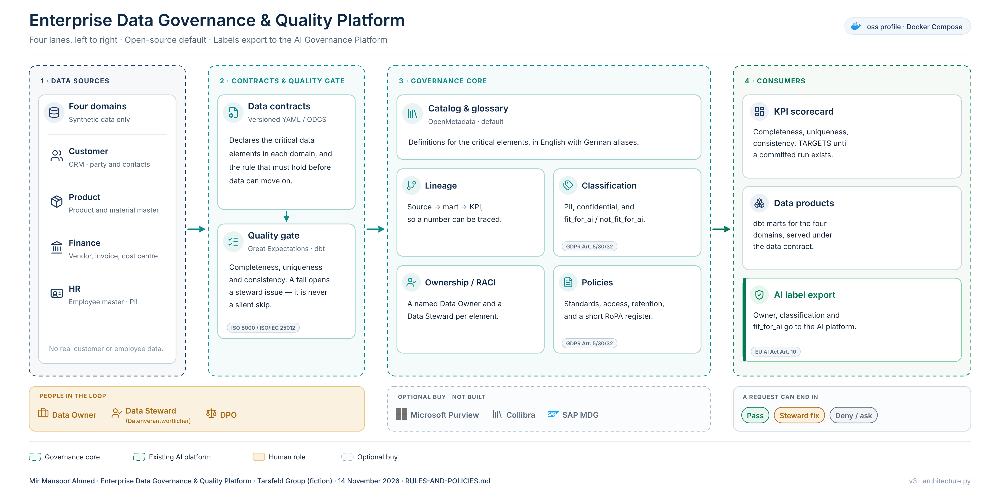

# Enterprise Data Governance & Quality Platform

A consulting case study, built as a runnable lab: a data-governance operating
model — catalog, data-quality rules, ownership/stewardship, master data,
lineage, GDPR (RoPA, retention, PII classification) and ODCS v3.2.0 data
contracts — over synthetic multi-domain data. Open-source core; optional
Azure-first adapters (Phase 9).

Fictional consultancy **Northwind Advisory**, fictional client **Tarsfeld Group
GmbH** (four domains: Customer, Product, Finance, HR). Synthetic data only. This
repo *publishes* classification, ownership and `fit_for_ai` labels; it does not
decide allow/ask/deny.

## Problem

Critical data sits in four domains across two country companies with mismatched
keys, a finance total that does not reconcile, and unclassified contact/HR
fields. Nobody can show which fields are critical, who owns them, which quality
rules apply, or which records may be used by an assistant. This lab stands up
the operating model that answers those questions.

## Architecture



Published icon figure: [`docs/diagrams/architecture.png`](docs/diagrams/architecture.png)
(generated by [`docs/diagrams/architecture.py`](docs/diagrams/architecture.py);
walkthrough in [`docs/diagrams/ARCHITECTURE-EXPLAINED.md`](docs/diagrams/ARCHITECTURE-EXPLAINED.md)).
Rules catalog: [`docs/RULES-AND-POLICIES.md`](docs/RULES-AND-POLICIES.md).
Design: [`docs/DESIGN.md`](docs/DESIGN.md).

## How to run (oss profile, no cloud account)

```
make validate   # structural validation of ODCS contracts + governance files
make test       # pytest: quality rules, schemas, lineage, workflow
make quality    # run the data-quality gate over the synthetic extracts
make scorecard  # KPI scorecard (placeholders until a committed run exists)
```

`make bootstrap` pulls the local OpenMetadata demo images once and is outside
the `make demo` clock. `make demo` and `make report` arrive in Phase 8; the
`hybrid` Azure profile arrives in Phase 9.

## Results

**TO BE MEASURED.** No quality scores, coverage or timings exist yet. Every
published number must come from a committed run file under `eval/results/` with
a UTC timestamp and git SHA. Until then the scorecard shows `TARGET` /
`TO BE MEASURED`.

## Status

Implemented: Phases 0–3 (repo foundation; synthetic data + ODCS contracts; dbt
marts + lineage descriptors; the quality gate for all `DQ-*` rules). Phases 4–9
are planned in [`tasks.md`](tasks.md).

## Limitations

Lab / portfolio design, not a production product, not legal advice, not a
GDPR/ISO/EU AI Act conformity assessment. Mappings are illustrative. SAP MDG,
Collibra, Informatica, Purview and Fabric are buy-vs-build documentation, not
implementations. The offline CI runs a standard-library quality engine as the
documented unit equivalent of Great Expectations / dbt / the official ODCS
schema validator (see [`design.md`](design.md) s10).
