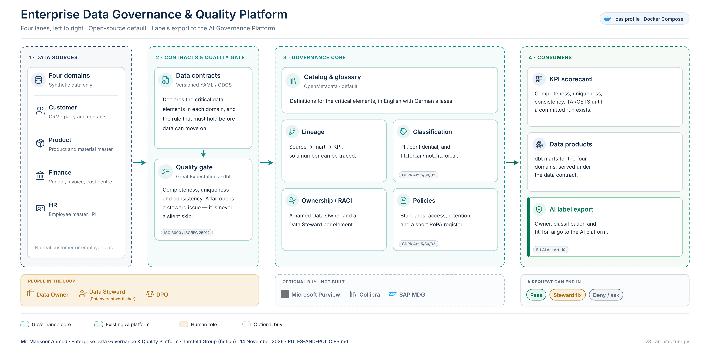

# Enterprise Data Governance & Quality Platform

**Design note (v0.3, implementation brief)** · Portfolio project by Mir Mansoor Ahmed
**Status:** design ready for spec · no implementation, no measured results
**Fictional consultancy in examples:** *Northwind Advisory*
**Fictional client:** *Tarsfeld Group GmbH* — a mid-to-large European group with operating companies in more than one country (not a real firm; not Vaillant, not any other real employer, and not the earlier “Rheinwerk Climate” heating story). Fictional figure, not copied from any real ad: about 6,000 employees, headquarters in Germany, customer, product, finance and HR data domains.
**Why this client:** the trigger Vaillant ad was only an example. The 33-ad general sample of 14 November 2026 spans manufacturing, pharma, banking, telecom, retail, media, automotive and consulting. A Sales & Commercial / SAP-O2C story, or a fintech-only client (NordPay), would miss most of those jobs.
**Umbrella:** sits beside the AI Governance Platform. Data that may feed an assistant or agent must carry classification and ownership labels into **AI Compliance Automation** and the **Agent Access Governance Gateway**. This repo publishes labels; it does not decide allow / ask / deny.
**Public name / repo (locked by Mir, 14 November 2026):** Enterprise Data Governance & Quality Platform · `enterprise-data-governance-quality-platform`
**Working folder for the design pack:** `/workspace/portfolio/data-governance-automation/`
**Date of this brief:** 15 November 2026 (Europe/Berlin), based on the v0.2 high-level design of 14 November 2026, plus verified Azure lab constraints and the Microsoft Purview Data Governance retirement announced 12 November 2026.

This is a lab / portfolio design, not a production product, not legal advice, and not a conformity assessment. Nothing here is a claim that Tarsfeld Group, or any real firm, is compliant or audit-ready. Metrics below are **TARGETS** only. SAP MDG is not implemented. A live Microsoft catalog (Purview or Fabric) is optional, unverified, and may be impossible to create on the student subscription — see §15.

Market evidence for the function list is in the 33-ad general sample of 14 November 2026 (`data-governance-market-general-2026-11.md` in the portfolio research folder). Concrete, source-cited quality rules and GDPR policies are in [`RULES-AND-POLICIES.md`](RULES-AND-POLICIES.md). That catalog is the traceable source for the quality gate (ISO 8000 and ISO/IEC 25012), classification and policies (GDPR Art. 5, 25, 30 and 32), operating-model rules (DAMA-DMBOK2R), and the `fit_for_ai` label (EU AI Act Art. 10). It is a lab design aid, not legal advice and not a certification or conformity claim.

A consulting narrative for the same design lives in [`CASE-STUDY.md`](CASE-STUDY.md).

---

## 1. Problem

Tarsfeld’s critical data is not in one commercial domain. It sits in four places at once: **Customer** (CRM extracts: party, contact, account), **Product** (product and material master, hierarchy), **Finance** (vendor, invoice, cost centre), and **HR** (employee master — synthetic PII only, and the most sensitive domain in the demo).

The same customer and product identifiers do not match across country companies and systems. Finance cannot reconcile vendor and invoice totals to the operational reports. HR and customer contact data are not consistently classified. A data-platform programme is planned, but nobody can show which fields are critical, who owns them, which quality rules apply, or which records may be used by an assistant. The works council and the DPO care about employee and customer contact data. A record of processing is incomplete. Assistants and coding agents are starting to be used in operations and finance, with no rule that data going into those tools must already be classified and owned.

The missing piece is this project: a versioned **data-governance operating model** for the critical data elements of all four domains, sitting on top of tools a firm like this would actually buy, and still runnable fully open source.

---

## 2. Scope and non-scope

**In scope (v1)**

- Synthetic data only, in four domains, for a German headquarters and one other country company. Intentionally dirty extracts so the demo can show mismatches, failed quality checks, and a steward cleanse.
- Business glossary (English with German aliases), data contracts in **Open Data Contract Standard (ODCS) v3.2.0** YAML, ownership / RACI, classification, lineage, quality rules from the catalog, a KPI scorecard, an issue / cleanse workflow, a lightweight access and retention policy, and a short GDPR record-of-processing register for customer and HR data.
- Two demo profiles, same code path, feature flags: `oss` (default, no cloud account) and `hybrid` (optional Azure adapters, after limits are checked). Azure is first where it is realistic — as **optional adapters with env-only config**, never as a hard dependency.
- An export of classification, ownership and `fit_for_ai` / `not_fit_for_ai` labels that AI Compliance Automation and the gateway can consume (fixture mode in this repo).
- `make demo` in under 15 minutes (after image pull) and `make report` (PDF case-study pack). The published architecture figure is the icon-based `docs/diagrams/architecture.png` (and `.svg`).

**Out of scope (v1)**

- Implementing SAP MDG, SAP S/4, Salesforce, Workday, or any real CRM / ERP / HRIS. A Buy vs. Build row explains when a client should buy SAP MDG or another MDM hub.
- Production Purview or Fabric rollout, Collibra, Informatica, Alation, Ataccama, or a real customer tenant. No paid Fabric F SKU.
- Invented quality scores, catalog coverage, latency, or hybrid-adapter numbers.
- Replacing the Agent Access Governance Gateway or rewriting AI Compliance Automation. This repo only *publishes labels*.
- Real customer data, real employee data, or any real employer brand. Uploading even synthetic HR PII to Azure.
- Legal sign-off, a works agreement, or a claim of GDPR / ISO / EU AI Act conformity.
- Production high availability, multi-region residency cut-over, or a second-cloud implementation.

---

## 3. Design principles

1. **Contracts, then checks, then a human decision.** ODCS contracts declare critical elements and rules. The quality gate measures them. A fail is never a silent skip: the gate blocks or quarantines, and a steward issue is opened.
2. **Operating model over tool tour.** Policies, RACI, issue workflow, RoPA, classification and the AI label export are the work a specialist actually does. Catalog and quality engines are bought or self-hosted around that model.
3. **Hybrid, portable by default. Azure first where realistic.** Microsoft services are optional adapters behind feature flags, used when the student subscription can actually host them. `make demo` and CI must pass with the open-source profile alone.
4. **Source-cited rules, no copied legal text.** Every automated check traces to an ID in `RULES-AND-POLICIES.md`. Mappings are illustrative.
5. **Labels, not verdicts, at the AI boundary.** This repo publishes `{asset_id, field, classification, owner, steward, fit_for_ai, policy_version, ...}`. OPA in the sibling projects decides allow / ask / deny.
6. **Privacy by default in the lab.** Synthetic data only. HR stays local. Retention jobs flag; they do not perform production deletion.

---

## 4. Functions mapped to the job-ad counts

These are the backlog the lab must be able to demo. Counts are from the 33-ad general sample of 14 November 2026.

| Function | Frequency (n = 33) | What the lab shows |
|---|---|---|
| Data quality rules, monitoring or KPIs | 30/33 | Great Expectations and dbt tests, plus a KPI scorecard, against the sourced rules in `RULES-AND-POLICIES.md` (ISO 8000 and ISO/IEC 25012). Figures are TARGETS until a committed run exists. |
| Ownership, stewardship or RACI | 24/33 | YAML register and a nomination / review view: Domain Data Owner, Data Steward (Datenverantwortlicher), DPO / IT. Why those titles are used is in `RULES-AND-POLICIES.md` §7. |
| Catalog or glossary | 20/33 | Default: OpenMetadata (catalog, glossary, tags). Glossary terms in English with German aliases. OpenMetadata itself was named in 0/33 ads; it is the honest OSS stand-in for the function, not a claimed market tool. |
| Policies and standards | 18/33 | Versioned policy files and a short standards note per domain, linked to the contracts, drawn from the catalog. |
| Master data / MDM | 16/33 | Synthetic master records in all four domains and a documented create-change-approve path. **SAP MDG is a buy recommendation (8/33 name the product), not a lab clone.** |
| Lineage | 13/33 | OpenMetadata + dbt lineage for at least one KPI dataset in each domain, source → mart → scorecard. |
| GDPR / privacy / classification | 13/33 combined | Tag set (`pii.contact`, `pii.hr`, `confidential.finance`, `master.customer`, `fit_for_ai` / `not_fit_for_ai`), a short RoPA for customer and HR, access and retention classes. Mapped policies: GDPR Art. 5(1)(c)(d)(e), Art. 25, Art. 30 and Art. 32. |
| DAMA-DMBOK or DCAM | 9/33 | The mapping table below, and operating-model rules (RACI, metadata, MDM) in the catalog. Not a certification claim. |
| SAP (any) | 11/33 | Optional connector *note* and a synthetic S/4-style extract format. Not implemented. |
| Named catalog products (Collibra 10, Informatica 10, Purview 6, Alation 4, Ataccama 1) | see rows | Buy-versus-build table and, for a Microsoft catalog only, an optional adapter behind a feature flag. Others are documented mappings, not implementations. |
| AI governance overlap | 7/33 | Label export consumed by AI Compliance Automation and the gateway, with `fit_for_ai` gated as in the catalog (EU AI Act Art. 10). This repo does not make the allow / deny decision. |
| Data contracts | 1/33 | Contracts are how standards become testable. They are in the lab because they make the demo honest, not because HR is searching for the phrase. |

**DAMA-DMBOK mapping (v1).** Knowledge-area names follow DAMA International’s public DMBOK2R materials (see the source map in the rules catalog). ISO/IEC 38505-1:2026 and ISO 9001:2026 are context only; ISO 9001 is not a data standard. There is no ISO 4001 in this design.

| DAMA knowledge area | Lab artefact |
|---|---|
| Data Governance and Stewardship | Policies, RACI, stewardship workflow, issue log (`GOV-RACI-01`) |
| Data Quality Management | Great Expectations / dbt tests, KPI scorecard (`DQ-*` rules) |
| Metadata Management | OpenMetadata catalog and glossary (`GOV-META-01`) |
| Data Architecture | Data contracts, documented source-to-mart path |
| Data Security | Classification, access policy, optional OPA (`POL-GDPR-06`) |
| Data Privacy | RoPA register, retention classes, PII tags (`POL-GDPR-*`) |
| Reference and Master Data | Synthetic masters; SAP MDG (or equivalent) as the buy option (`GOV-MDM-01`) |
| Data Warehousing & BI | dbt domain marts and the scorecard |
| Data Storage & Operations | Retention class and a report field only; no production deletion |

DCAM is listed as an equivalent reference in the pack (3/33 ads name it), not as a second implemented model.

---

## 5. Architecture

*Published figure (icon-based): [`diagrams/architecture.png`](diagrams/architecture.png) and [`diagrams/architecture.svg`](diagrams/architecture.svg), generated by [`diagrams/architecture.py`](diagrams/architecture.py). A second figure, [`diagrams/architecture-explained.png`](diagrams/architecture-explained.png), is the same diagram with a numbered legend underneath. A plain-language walkthrough is in [`diagrams/ARCHITECTURE-EXPLAINED.md`](diagrams/ARCHITECTURE-EXPLAINED.md). Source-cited rules are in [`RULES-AND-POLICIES.md`](RULES-AND-POLICIES.md).*

**How to read it.** Synthetic extracts from four domains land under **data contracts**. **dbt** builds domain marts. **Great Expectations** (and dbt tests) run the quality rules catalogued in the rules file. The centre is the **governance core** around the critical data elements: catalog and glossary, lineage, classification, ownership / RACI, and policies (including a short RoPA). **OpenMetadata** is the default catalog. **Microsoft Purview**, **Collibra** and **SAP MDG** sit on the diagram as optional or recommended buys, not as boxes we build. A Microsoft catalog may later be an adapter, behind a feature flag, if an account can actually be created — see §15, including the November 2026 Purview Data Governance retirement. Our code holds the operating model. Classification, ownership and `fit_for_ai` labels are exported to **AI Compliance Automation** and the **gateway**. People in the loop are the **Data Owner**, the **Data Steward (Datenverantwortlicher)** and the **DPO**. Request outcomes: pass, a steward fix, or deny/ask (the last of those is decided by the sibling PEP, not this repo).

**Two demo profiles** (feature flags, same code path):

| Profile | When | Sources | Catalog / lineage / classification | Quality | Identity | Evidence |
|---|---|---|---|---|---|---|
| `oss` (default) | CI, offline `make demo`, no cloud account | Local CSV/Parquet extracts in the repo (all four domains, including HR) | OpenMetadata (self-hosted in Compose) for local demo; recorded catalog fixtures in CI | Great Expectations + dbt tests | Local users / Keycloak | Files + PDF report; optional Streamlit or Grafana board |
| `hybrid` | Optional demo after a portal create-test-delete session | Same local extracts, **plus** optional Azure SQL Database (free serverless) and/or Azure Blob Storage as adapters for non-HR domains | OpenMetadata *plus* a Microsoft catalog adapter (Purview / Fabric OneLake catalog) if, and only if, a usable account exists; otherwise the adapter stays mocked and the report says so | Same OSS path | Entra ID group-to-owner/role mapping if group claims work (unverified); else local / Keycloak | Same report contract, plus optional Azure Monitor, plus a HYBRID.md note on what Azure did and did not do |

---

## 6. Data model and rule catalog (v1 starter set)

Encode the catalog in `docs/RULES-AND-POLICIES.md` as machine-checkable artefacts (ODCS contracts, Great Expectations / dbt tests, policy YAML, RoPA YAML, RACI register, label-gate checks). Do not drop a rule. Do not invent clause numbers the catalog marked as unverified.

**Quality rules (ISO/IEC 25012 dimensions; ISO 8000 measuring / process / contract-conformance principles):**

| ID | Domain | Check | Severity | Action on fail (summary) |
|---|---|---|---|---|
| `DQ-CUS-001` | Customer | Email present and syntactically valid against the contract pattern | high | Fail gate; quarantine; steward issue; no export; no `fit_for_ai` |
| `DQ-CUS-002` | Customer | `customer_id` present and unique across the two country companies | critical | Fail gate; block customer data product and campaign export; steward issue to resolve or merge keys |
| `DQ-CUS-003` | Customer (Finance consulted) | When `vat_id` is present, country code + character block matching the contract’s per-country pattern; empty only where the contract allows | high | Fail gate for the row; steward issue; do not use the VAT ID on a synthetic invoice or export |
| `DQ-PRD-001` | Product | Mandatory attributes present: `product_id`, `name`, `status`, `unit_of_measure` | high | Fail gate; hold out of the product data product; steward issue |
| `DQ-FIN-001` | Finance | `cost_centre_id` exists and is active in the company-code reference list | critical | Fail gate; block finance mart load for the row; steward issue; do not publish the related KPI |
| `DQ-HR-001` | HR | `status`, `effective_from`, `last_verified_on` within the contract currentness window; leavers have `effective_to` | high | Fail gate; quarantine; steward issue; `not_fit_for_ai`; no assistant or export path |

VAT national patterns such as “DE + nine digits” must **not** be cited as official; they were not on the official pages verified on 14 November 2026. The contract may hold a lab pattern for the synthetic set, labelled as a contract parameter.

**GDPR policies (each mapped to a check or workflow):** `POL-GDPR-01` minimisation (Art. 5(1)(c), Art. 25(2)); `POL-GDPR-02` accuracy and kept up to date (Art. 5(1)(d)); `POL-GDPR-03` storage limitation / retention flags (Art. 5(1)(e), Art. 30(1)(f)); `POL-GDPR-04` RoPA completeness (Art. 30(1)(3)); `POL-GDPR-05` protection by design and by default in the contract (Art. 25); `POL-GDPR-06` security of processing and access (`pii.contact`, `pii.hr`) (Art. 32).

**Operating-model rules (DAMA-DMBOK2R):** `GOV-RACI-01` named Data Owner + Data Steward (Datenverantwortlicher) for every critical element; `GOV-META-01` glossary + technical metadata + classification + links to contract and quality rule; `GOV-MDM-01` documented system of record and create-change-approve path for `customer_id` and `product_id` (synthetic only; buy SAP MDG in a real SAP landscape).

**AI label:** `AI-FIT-01` — `fit_for_ai` only if ownership, classification, relevant quality-gate rules, applicable POL-GDPR-01/02/04/06, and lineage are in place; otherwise `not_fit_for_ai`. Article 10 applies to data used for high-risk AI systems. This platform is not itself a high-risk AI system, and the mapping is not a conformity assessment.

**Role note.** Print the bilingual operating-model label **Data Steward (Datenverantwortlicher)**. Do not treat that person as the GDPR Art. 4(7) controller (*Verantwortlicher*), which is usually the organisation. The DPO is a separate statutory function. The Data Owner is RACI-accountable for the domain or element.

**ODCS contracts.** One contract per domain data product (and reference lists where needed), `apiVersion: v3.2.0`, `kind: DataContract`, official schema validation, media type `application/odcs+yaml;version=3.2.0`. Custom properties may hold lab policy IDs, classification, owner, steward, and retention class. Do not claim the contract is a certified ODCS product.

---

## 7. Buy vs. Build

| Component | Microsoft-native | Commercial vendor | Open source | We build | Chosen in the demo |
|---|---|---|---|---|---|
| Catalog, glossary, lineage | Microsoft Purview Data Governance is **retiring** (announced 12 Nov 2026; new accounts may no longer be creatable; maintenance through 12 Nov 2027). Successor: Fabric OneLake catalog (capacity-billed; student/trial availability **unverified**). | Collibra (10/33), Alation (4/33), Informatica (10/33), Atlan (1/33) | **OpenMetadata** (default, 0/33 ads); DataHub is a documented alternative | Asset mapping, term YAML, adapters | **`oss`:** OpenMetadata. **`hybrid`:** same terms published to a Microsoft catalog *if* an account can be created; otherwise mocked adapter + honest report note |
| Data quality | Purview / Fabric quality features only if they exist on an available account (TODO; do not assume) | Informatica DQ, SAP MDG validation, Ataccama (1/33) | **Great Expectations**, dbt tests; Soda is a documented alternative | The rule pack and the KPI scorecard | **GE + dbt in both profiles** |
| Sources | **Azure SQL Database** free serverless offer; **Azure Blob Storage** Hot LRS | Source systems the client already has | Local files, optional Postgres in Compose | Ingestion adapters and contract enforcement | **`oss`:** local files. **`hybrid`:** Azure SQL and/or Blob for non-HR domains, if the portal allows, then delete |
| MDM / create-change-approve | Not a Microsoft sweet spot for SAP master data | **SAP MDG** / S/4 master-data hub (8/33); Stibo, Reltio, Profisee appear in individual ads | None that replaces SAP MDG in an SAP landscape | Only a documented process and, optionally, a thin approval mock | **Buy MDM** in the recommendation when the client has that pain; lab uses synthetic masters |
| Classification / labels | Purview sensitivity labels (security/compliance side of Purview, still current, usually licence-gated — not assumed on Azure for Students) | Collibra / Informatica classification | OpenMetadata tags | The tag set and the export schema for the AI platform | Tags in OpenMetadata; Microsoft labels optional and unverified |
| Access / retention | Purview + Entra; Fabric OneLake security if Fabric exists | Vendor GRC / SAP authorisations | OPA, policy YAML | The policy file | Policy YAML in both profiles |
| GDPR / RoPA | Microsoft Priva / privacy manager (not assumed available) | OneTrust and others | Our register | A short RoPA for customer and HR data | **Our register** in both profiles |
| KPI dashboard | Power BI (named in a few ads; natural Microsoft option, unverified here) | Various BI tools | Streamlit, Grafana, or a static HTML report | The queries and the target metrics | **`oss`:** Streamlit, Grafana, or static HTML. Power BI only if later verified |
| Identity | Entra ID | Okta and others | Keycloak | Adapter only | **`oss`:** Keycloak / local. **`hybrid`:** Entra if group claims work (unverified) |
| Evidence / telemetry | Azure Monitor / Log Analytics (optional, smallest workspace, short retention) | SIEM products | Files, PDF, optional Grafana | The report contract | Files + PDF in both profiles; Azure Monitor optional |
| AI-use control | Copilot / Purview policy (siloed) | Various AI-governance vendors | Our AI Compliance Automation + gateway | The label export (`classification`, `owner`, `fit_for_ai`) | **Existing gateway + Compliance Automation consume labels** |

**Why hybrid, not “Microsoft-only” or “OSS-only”.** Some clients already license Microsoft 365, Azure, or a catalog such as Collibra or (historically) Purview; some industrial clients will buy SAP MDG. The differentiated work a specialist actually does — definitions, ownership, quality rules, issue handling, evidence, and the rule that AI may only see classified, owned, quality-gated data — is not something a catalog licence does by itself. Those pieces stay ours, and they stay runnable without a cloud login. Azure is used first where a free or tiny resource in Germany West Central can honestly show a Microsoft estate: structured and file sources, identity mapping, optional telemetry, and a catalog adapter if one can still be created.

---

## 8. Tie-in to the AI Governance Platform

1. Every critical element in the glossary carries a classification and an owner.
2. The lab publishes a versioned label pack, for example `{asset_id, field, classification, owner, steward, fit_for_ai, policy_version}`.
3. **AI Compliance Automation** (Semantic Guard + OPA) and the **Agent Access Governance Gateway** may use those labels on the slow path. A fixture in this repo replays: a request for a customer extract or employee list tagged `pii.contact`, `pii.hr`, `confidential.finance`, or `not_fit_for_ai` returns `deny` or `ask`; a comparable request on an already-approved, non-PII KPI aggregate is allowed.
4. This repo does not make the allow / deny decision and does not store prompt bodies.

---

## 9. Demo script (`make demo`, under 15 minutes after image pull)

Fictional setting: Northwind Advisory at Tarsfeld Group. Synthetic data only. Default profile: `oss`. The same path must also run under `hybrid` when adapters are configured; hybrid must still run (with mocks) when Azure credentials are absent.

1. **Brief (about 2 minutes).** Four domains. Show mismatched customer and product keys across two country companies, a finance total that does not reconcile, and HR contact fields with no classification. Show the as-is extracts and the glossary gaps.
2. **Catalog, glossary and ownership.** Open OpenMetadata (or the report screenshots / fixtures in CI). Show definitions for one critical element in each domain, in English with German term aliases. Show the named Domain Data Owner and the Data Steward (Datenverantwortlicher).
3. **Quality and KPIs.** Run the rule pack. Show the scorecard with TARGET metrics only, or “to be measured” if this is the first run: completeness, uniqueness, consistency, currentness, and a small set of cross-domain key matches.
4. **Issue and cleanse.** Pick one failed record (duplicate customer, or an employee row missing a required classification). Open the steward issue, record the decision, apply the documented cleanse, re-run the rule. This is the business–IT interface.
5. **Classification and the AI bridge.** Show customer email tagged `pii.contact` and an employee field tagged `pii.hr`. Replay a request (“export these customers for a local campaign” or “ask the assistant for the employee list”). The gateway / Compliance Automation fixture returns `deny` or `ask`. A comparable request on an already-approved, non-PII KPI aggregate is allowed.
6. **Buy vs. Build close (about 2 minutes).** Point at the table: buy a catalog if the firm already has a Microsoft catalog, Collibra, or similar; buy SAP MDG when master-data workflow is the pain; keep OpenMetadata + Great Expectations as the path that still works; keep ownership, issues, evidence and the AI label export as our work. `make report` writes the PDF.

---

## 10. Metrics *(TARGETS — nothing measured yet)*

No number in a README, report or CV bullet may be invented. Every figure must come from a committed run with timestamp and git SHA. Until then, write **TARGET** or “to be measured”. Persist runs under something like `eval/results/` (quality scorecard, coverage, demo duration, and, when a hybrid session happens, a separate hybrid note that does not blend mocked and live results).

| Metric | What will be measured | TARGET (design budget, not a result) |
|---|---|---|
| Glossary coverage | Share of the declared critical elements, across all four domains, that have a definition, owner and steward | Floor set once the starter element list is encoded; no percentage is claimed now |
| Quality — completeness, uniqueness, consistency, currentness | Required fields, duplicate keys, currentness window, and cross-system key matches in the synthetic set | To be measured and published together |
| Classification coverage | Share of PII and confidential fields that carry a tag | To be measured |
| Lineage coverage | At least one KPI dataset per domain has documented lineage to its source extracts | Binary for v1: yes / no on the declared datasets |
| Issue cycle (process) | Time from a failed rule to a recorded steward decision in the demo | Process metric only; not a production SLA |
| AI-label use | Share of fixture tool calls that touch domain data and carry a classification label | To be measured on the fixture set; not a live-traffic claim |
| `make demo` duration | Wall clock on the `oss` profile, after images are pulled | Under 15 minutes |
| Hybrid adapter smoke (when run) | Which adapters were live vs mocked, region, SKU, and that teardown completed | Narrative + any real cost from the portal; never a blended quality score |

---

## 11. Candidate CV keywords

These are keywords the project can *earn* once it is built and demoed. They must not appear as skills until the corresponding artefact exists. Suggested set (three to four, not a dump of every tool on the diagram):

1. **Data governance operating model** — policies, standards, RACI / stewardship, issue workflow, DAMA-DMBOK mapping.
2. **Data catalog, business glossary and data lineage** (OpenMetadata; Microsoft Purview or Fabric only if that exact adapter was actually demonstrated).
3. **Data quality rules and KPI monitoring**, with a scorecard and a documented cleanse path.
4. **Data classification and GDPR-oriented records**, including labels consumed by an AI access gateway.

Do **not** put “SAP MDG”, “Collibra”, “Purview”, or “Microsoft Fabric” on the CV from this lab alone, unless that exact adapter was demonstrated. “Synthetic multi-domain master data and a documented recommendation to buy SAP MDG / a catalog where the client already has one” is the honest wording.

---

## 12. Risks

| Risk | Mitigation |
|---|---|
| Over-claiming SAP MDG, Collibra, Purview or Fabric hands-on | README, report and CV use the wording in §11. MDG and Collibra are buy recommendations. Microsoft catalog sync is optional and may be blocked by retirement or tenant policy. |
| Student-account features missing, region-locked, or paid-only | Feature flags; `oss` is the supported default; portal check before any credit is spent; create-test-delete; budget alert already on the $90 credit (expires 7 November 2027). |
| Purview Data Governance retirement (12 Nov 2026) | Do not design the demo so it fails without a Purview account. Keep an adapter interface; prefer Azure SQL, Blob, Entra and optional Monitor as the live hybrid proof. |
| Demo looks like a tool tour, not a specialist’s job | The 15-minute script is driven by the high-frequency job functions (quality, ownership, catalog, policies, privacy), not by product screens. |
| Works-council or DPO concern if the story used real people | Synthetic data only; HR stays off Azure; RoPA is a template, not a compliance claim. |
| Inventing a client that happens to be a real firm | The name *Tarsfeld Group GmbH* was searched on 14 November 2026 and did not match a real company in the results. It must not be replaced by a real employer brand. |
| OpenMetadata too heavy for CI or a cold 15-minute demo | Local demo uses Compose after `make pull`. CI uses recorded catalog fixtures. Demo clock starts after images are present. |

---

## 13. GitHub-native harness

- ODCS contracts, policy YAML, RACI, RoPA and label schemas are validated in CI.
- CI on every PR, on the `oss` profile only: schema validation, dbt tests, Great Expectations (or a unit equivalent that exercises the same rules), workflow tests, label-export tests, adapter-absent tests, and a coverage / scorecard report that prints TARGET or the last committed figures.
- `make report` builds a PDF case-study pack: brief, diagnosis, options, solution (link to this design and the icon figure), results (committed run or TO BE MEASURED), roadmap. The renderer fails closed if required fields are missing or if a results table contains a number with no run file.
- `make demo` runs the script in §9 in under 15 minutes after image pull, defaulting to `oss`.

---

## 14. Implementation phases (for tasks.md)

Each phase must be demoable on its own once complete. Prefer small, testable slices. `oss` first.

0. Repo foundation: Makefile, Compose skeleton, CI, JSON/ODCS schemas, docs placement, commit conventions.
1. Synthetic data + ODCS v3.2.0 contracts (four domains, two countries, dirty extracts).
2. dbt domain marts + lineage (one KPI path per domain).
3. Quality gate: all `DQ-*` rules; scorecard TARGETS until a committed run exists.
4. Catalog, glossary (EN+DE), ownership / RACI, `GOV-*`.
5. Classification, RoPA, retention flags, access policies `POL-GDPR-01`–`06`.
6. Steward issue / cleanse workflow and re-run.
7. `AI-FIT-01` label export + fixture consumer.
8. `make demo`, `make report` PDF, eval/run persistence, README.
9. Hybrid adapters + `docs/HYBRID.md` (see §15). Live portal session only when Mir says go; then teardown.

---

## 15. Azure student account and hybrid adapters

**Verified in the Azure portal on 14–15 November 2026 (Europe/Berlin):** the lab subscription is **Azure for Students**, with **USD $90** credit, expiring **7 November 2027**, in the **IU tenant**. A **budget alert already exists**. Only **Germany West Central** is allowed; Sweden Central and West Europe were policy-blocked. **Azure CLI device-code login is blocked** by IU Conditional Access (error 53003, unregistered Linux device). The **portal works**. Resource creation for any hybrid demo is therefore **portal-only**, documented in `docs/HYBRID.md`. A previous ACA hybrid resource group on this subscription was deleted; measured cost was 0.

The `hybrid` profile may use this account. The `oss` profile remains the one CI guarantees, and `make demo` must still run with no Azure credentials. Tests use **mocked adapters**. Configuration is **environment variables only** (prefix `DG_`). Do not commit secrets. Do not publish the subscription ID in the README or the case-study PDF.

**Resource rule:** smallest or free tiers only; create → test → delete in the same session. Never leave a paid or pause-disabled resource running.

### 15.1 Adapters to implement (Azure first where realistic)

| Adapter | Intended SKU / setup | Why | Live-run expectation |
|---|---|---|---|
| Azure SQL Database source | Free offer, General Purpose **serverless**, 100,000 vCore-seconds/month, 32 GB data + 32 GB backup, **Germany West Central**. Auto-pause after 15 minutes idle **and** auto-pause when the monthly free limit is hit. **Never** select “continue with charges”. The first free-tier database locks the region for later free databases, so it must be this region. | Realistic structured source for Finance or Customer, to exercise contract load and (for Finance) `DQ-FIN-001`. | Likely, if the student policy allows the free offer (portal TODO). |
| Azure Blob Storage source | StorageV2, **Hot LRS**, smallest account, short-lived container, Germany West Central. | File landing zone for Product extracts (CSV/Parquet). Fallback if SQL is blocked. | Likely. |
| Entra ID | Group-to-owner / steward / role mapping adapter. `oss` keeps local users or Keycloak. | Azure-first identity, same idea as the ACA hybrid profile. | Unverified: whether this student / IU tenant allows an app registration and group claims. Mock if not. |
| Azure Monitor / Log Analytics (optional) | Smallest workspace, shortest retention, Germany West Central. Typical first 5 GB/month analytics ingestion is free; do not leave the workspace running. | Optional hybrid evidence sink. | Optional. Skip if the SKU is not clearly free or tiny. |
| Microsoft catalog sync | Interface that publishes the same glossary terms, assets and tags. Backends: mock (required), plus a live backend only if a usable account exists. | Azure-first catalog was the original plan; retirement changes what we can actually create. | **Unlikely.** See §15.2. |

**HR domain stays local.** Do not load synthetic employee PII to Azure SQL or Blob.

Suggested env vars (names may be refined, but keep the `DG_` prefix and env-only rule): `DG_PROFILE`, `DG_AZURE_SQL_SERVER`, `DG_AZURE_SQL_DATABASE`, `DG_AZURE_SQL_USER`, `DG_AZURE_SQL_PASSWORD`, `DG_AZURE_STORAGE_ACCOUNT`, `DG_AZURE_STORAGE_CONTAINER`, `DG_AZURE_STORAGE_KEY` or SAS, `DG_ENTRA_*`, `DG_AZURE_MONITOR_*`, `DG_CATALOG_BACKEND=mock|purview|fabric`.

### 15.2 Microsoft catalog reality check (as of 15 November 2026)

On **12 November 2026** Microsoft announced that **Microsoft Purview Data Governance** is retiring, covering Unified Catalog, Data Map, Workflows, and classic Azure Purview. Microsoft Learn pages for Unified Catalog and related governance docs now state that **new accounts can no longer be created**, and that existing capabilities remain in maintenance mode through **12 November 2027**. Official transition narrative: *From Purview Data Governance to the Fabric OneLake Catalog* (Microsoft Community Hub, 13 November 2026). Fabric is the successor data-governance experience; governance there is included in Fabric capacity rather than a separate Purview meter. **Purview data security and compliance** (sensitivity labels, DLP, audit) continues and is a different product; it is usually licence-gated and is **not** assumed to be available on Azure for Students.

Germany West Central is a Fabric region, and Microsoft documents a 60-day Fabric trial (F4 or F64) that must be cancelled to avoid leftover workspaces. Trial enablement, tenant limits, and whether an IU student user can start a trial are **unverified**. A paid Fabric F SKU must **not** be purchased against the $90 credit. Do **not** start a Fabric trial unless Mir explicitly says go after a cost and tenant-settings check, and only if the trial region can be Germany West Central and teardown happens the same day.

If neither Purview nor Fabric can be created, the hybrid demo is still a success when Azure SQL and/or Blob (and optionally Entra / Monitor) run live, and the catalog adapter remains mocked. Say that plainly in the report.

### 15.3 `docs/HYBRID.md` runbook (required in Phase 9)

Must include:

- Prerequisites: budget alert confirmed; region Germany West Central only; portal-only steps (no Azure CLI device login); IU Conditional Access note.
- Exactly which resources to create, SKU, region, name pattern, and estimated cost (free offer vs risk of overage).
- Environment variables and how they are supplied (never committed).
- Smoke tests: load one non-HR domain from Azure, run the quality gate, show whether catalog sync was live or mocked.
- **Teardown checklist** (delete resource group / account / workspace / trial), and a reminder to capture the portal cost or zero-charge screenshot into the run folder before deletion if a cost figure will be reported.
- A results section filled only after a real session, with timestamp and git SHA, separating live adapters from mocks.

### 15.4 Still unverified (TODOs before a live hybrid session)

- [ ] Confirm the Azure SQL free offer can be created on this student subscription in Germany West Central, with auto-pause on limit (not continue-with-charges).
- [ ] Confirm a tiny StorageV2 Hot LRS account can be created and deleted the same day.
- [ ] Entra: app registration and group claims (including any student-plan or Conditional Access limits).
- [ ] Azure Monitor: whether a smallest Log Analytics workspace is clearly free or tiny enough to use and delete the same day.
- [ ] Whether any Microsoft catalog path remains creatable (legacy Purview account, tenant Purview Discovery Plan, or Fabric trial in Germany West Central). Default assumption: **no**, until a portal check says otherwise.
- [ ] Re-check Microsoft Learn retirement wording at implementation time; it may move again.

---

## 16. Limits and sources

- No quality scores, coverage percentages, or demo timings exist yet. All figures are **unknown** until a committed run.
- GDPR, ISO and EU AI Act mappings are illustrative. Full ISO texts are paid standards; only public abstracts and official OJ / EUR-Lex wording cited in the rules catalog were used.
- This document does not create a GitHub repository and does not spend Azure credit.

*Sources: design pack `DESIGN-HIGHLEVEL.md` and `RULES-AND-POLICIES.md` (14 Nov 2026); 33-ad general sample (14 Nov 2026); Azure lab checks (14–15 Nov 2026, Europe/Berlin); Microsoft Learn Unified Catalog region / retirement banners; Microsoft Community Hub, “From Purview Data Governance to the Fabric OneLake Catalog”, 13 Nov 2026; Azure SQL Database free offer docs; ODCS v3.2.0 (Bitol, released 8 Sep 2026). Design brief date: 15 Nov 2026, Europe/Berlin.*
